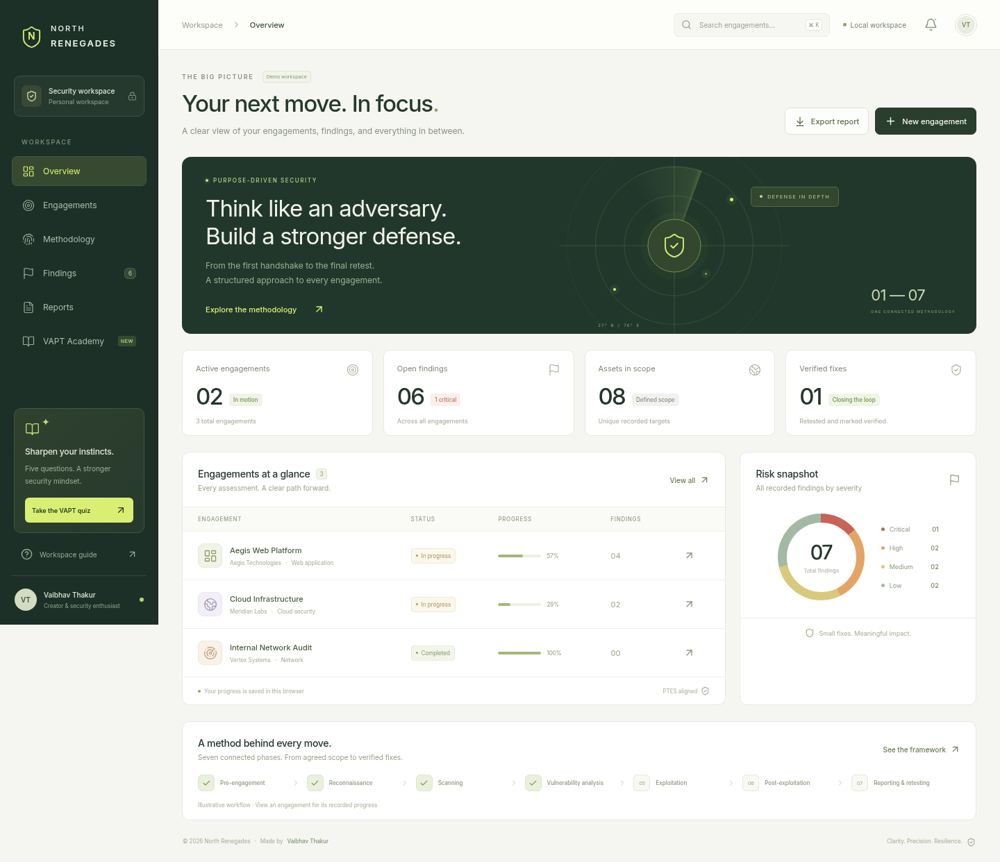

# North Renegades

**A VAPT engagement workspace, made by Vaibhav Thakur.**



North Renegades brings the full penetration-testing project lifecycle into one responsive interface: plan an authorized assessment, track execution, record evidence, prioritize remediation, and document retesting. Its forest-green, warm-neutral, and lime design is built for a clear view at normal browser zoom, from mobile to desktop.

## What is included

| View         | Capabilities                                                                                                                                                                      |
| ------------ | --------------------------------------------------------------------------------------------------------------------------------------------------------------------------------- |
| Overview     | Engagement metrics, risk distribution, progress, and a seven-phase workflow                                                                                                       |
| Engagements  | Create and edit assessments; record in-scope and excluded assets, testing approach, written authorization, testing windows, communication contacts, and emergency stop procedures |
| Methodology  | Seven searchable, filterable, expandable phases aligned with PTES, OWASP WSTG, and NIST SP 800-115                                                                                |
| Findings     | Record severity, business impact, sanitized evidence, actionable remediation, and retest status                                                                                   |
| Reports      | Preview an executive summary; download an editable Markdown report with scope, rules of engagement, technical findings, remediation, and retest details; export workspace JSON    |
| VAPT Academy | Exactly five interactive scenario questions with explanations, final score, retry, and a saved personal best                                                                      |

The methodology covers pre-engagement, reconnaissance, scanning and enumeration, vulnerability analysis, controlled exploitation, post-exploitation and cleanup, and reporting and retesting. It explains scope changes, safe validation, agreed privilege/lateral-movement/persistence simulations, and artifact cleanup.

## Run locally

Use **Node.js 22 or newer** and npm. Node.js 24 was used for development.

```sh
npm ci
npm run dev
```

Open the address printed by Vite in your local development environment. The development server listens on all interfaces by default. Use `npm run dev -- --host 127.0.0.1` for loopback-only development.

In a cloud workspace where the home directory is not writable, use a writable npm cache:

```sh
npm ci --cache /workspace/.npm-cache
```

Create and serve a production build:

```sh
npm run build
npm run preview
```

The generated static site is in `dist/`. Vite uses a relative base path so the build can be hosted under a subdirectory. The application uses hash navigation and does not require a server-side router. Fonts are packaged locally; no external font service is needed.

## Browser tests

```sh
npm test
```

Playwright automatically uses `/usr/bin/chromium` when present. To use another system Chromium executable, set `PLAYWRIGHT_CHROMIUM_EXECUTABLE_PATH` to its path. If no system Chromium is available, install Playwright's browser first:

```sh
npx playwright install chromium
npm test
```

Tests start a local Vite server if needed. They verify engagement creation and persistence, phase tracking, finding updates and retest status, Markdown/JSON exports, all five quiz questions, methodology filtering, and document fit at 1440, 1280, 1024, and 390 pixels. The browser is launched with `--no-sandbox` for compatibility with the isolated cloud test container; this does not disable application checks.

## Data and project boundaries

This is a client-side React and TypeScript application. It has **no backend, account system, scanner, or exploit runner**. It does not perform security testing against any target. The initial engagements and findings are clearly labeled synthetic demonstration data, using documentation IP addresses and `.example` domains.

Workspace records are saved to this browser's `localStorage`. Clearing browser data removes them. Private browsing, blocked storage, another browser profile, or another device may not retain the same workspace. When storage is unavailable, the current session remains usable in memory. Use **Reports → Export workspace data** to download a JSON backup; the current version exports backups but does not import them.

Reports contain the data entered by the operator. Sample findings are not evidence of a real assessment. Review scope, evidence, severity, remediation owners, target dates, and retest outcomes before sharing. There is no file-attachment uploader; use the evidence field to record sanitized reproduction notes and references to securely retained screenshots or logs. Do not place credentials, sensitive customer data, or unredacted evidence in browser storage or the repository.

Testing activity must follow the asset owner's written authorization and agreed rules of engagement. Completing a checklist records an operator decision; it does not automatically validate a phase or finding. The learning quiz is educational and is not a professional certification.

## Technology

React 19 · TypeScript · Vite · Lucide icons · Inter · Playwright

Created by **Vaibhav Thakur** for **North Renegades**.
